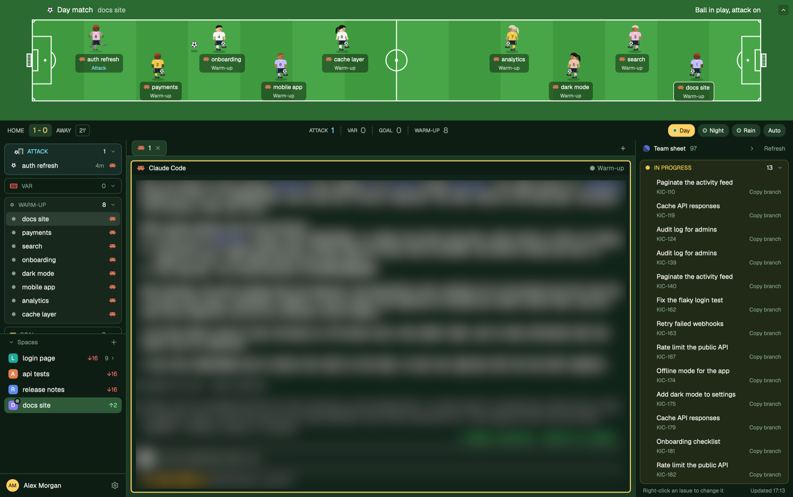

# Soccer + Linear

A soccer pitch for your coding agents, with your Linear issues beside it. Every agent is a player on a top-down pitch: agents at work pass a ball, agents that need you call for VAR, finished ones score a goal, and idle ones warm up juggling. A scoreboard counts each status, keeps a daily score and switches between three pitches: day, night and rain. On the right, "Team sheet" lists the Linear issues assigned to you, grouped by status, shows which ones an agent is on, and lets you change them or kick one off with a new agent in a fresh worktree.

## Words used here

- **Agent status**: Herdr reports each agent as `working`, `blocked` (waiting for you), `done` (finished while you weren't looking), `idle` or `unknown`. This layout calls them Attack, VAR, Goal, Warm-up and Warm-up.
- **Pitch**: the drawing at the top. Each pitch is a Herdr theme (`themes/soccer-<name>.json`) plus a row in the `PITCHES` table in `mods/soccer/main.js` with the colors the mod draws.

## What you see

Top to bottom:

1. **Pitch**, 230px tall (drag between 38 and 420px).
   - Surround in the pitch's outside color, with the pitch inset `max(60px, 4%)` from the left and right and `max(34px, 16%)` top and bottom, ending 40px before the bench when the bench shows.
   - Grass mown in 14 vertical bands alternating grass and stripe colors.
   - White 2px markings, sized from the pitch height `h` so they keep their shape at any width: boundary; halfway line; center circle of radius `0.135h` and a 3px center spot; at each end a penalty box `0.243h` deep and `0.593h` wide, a goal area `0.081h` deep and `0.27h` wide, a penalty spot `0.162h` from the line, the penalty arc (a circle of radius `0.135h` around the spot, clipped to the part outside the box) and 7px corner arcs.
   - Goals outside each end line: 10px deep, `max(26px, 0.16h)` wide, a `#ffffff1f` fill with a `#ffffff55` net grid and a 2px white frame.
   - Top left, at least 90px in to clear the window buttons, in a 20px row centered 19px from the top: an 11px ball, the pitch name (14px, 800) and the active space's name (13px, `#ffffffb0`). Above the pitch's right end: the referee's call (13px, 700).
   - A 20px fold arrow (`#00000033` square, white chevron) in the top-right corner folds the pitch to a 38px bar holding the ball, the pitch name, the space and the referee's call, with a down arrow to unfold it (`layout.resize` on block `soccer-pitch`, 38 or 230px; remembered in `localStorage` key `soccer.pitch.folded`). `cmd-shift-j` does the same when bound (see Built from).
   - Night adds a soft glow (circle of radius `0.9h`, `#fff4c408`) at each pitch corner and a floodlight bank (four 3.5px `#fff6d6` lamps on a `#2a3442` plate) beside each corner. Rain adds five `#ffffff16` puddles and 44 falling streaks (1.5 x 12px, `#d6e6ff66`, each looping from above the block to below it in 650 to 1100ms).
2. **Scoreboard**, 38px, `chrome` background.
   - Left: "HOME" (11px, 800, `muted`), the score `<goals> - <waits>` (14px, 900, `accent`, on a `raised` pill), "AWAY", and the match clock (`<minutes>'`, 11px, 700, in a 1px `border` box). HOME counts agents that turned `done` today; AWAY counts times an agent turned `blocked` today. Each word and the clock explain themselves in a tooltip.
   - Center: four cells, ATTACK, VAR, GOAL and WARM-UP (idle and unknown together), each a 10px label in `muted` and a 15px count in the status color (`dim` when 0), split by 1px x 18px `border` dividers.
   - Right: pitch chips Day, Night and Rain (an 8px swatch of the grass with a line-colored border, then the name), and Auto. The shown pitch's chip is `accent` with `accent_foreground` text; while Auto is on, only Auto is highlighted and reads "Auto · Day" or "Auto · Night".
3. **Work area**, three columns.
   - Left, 240px: an agents panel over Herdr's Spaces list (half the height each; drag the divider between them), and under them a fixed 44px strip with your initials in a 24px `accent` circle, your name (12.5px, 600) and a 26px settings button that runs `app.settings`. The name is your macOS account's full name (`id -F`), or your home folder's name if that fails.
   - The agents panel shows four cards in this order: **Attack**, **VAR**, **Warm-up**, **Goal**. Each card sits 8px in from the panel edges, 6px apart, with 8px corners, a background of its status color at 8% (`14` alpha) and a border at 25% (`40` alpha); an empty card is plain `chrome` with a `border` border. Its 28px header shows a marker, the name (11px, 800, uppercase, in the status color, `dim` when empty), the count and a fold chevron (remembered in `localStorage` key `soccer.groups.folded`). Header markers: Attack, an 8px ball rolling into a 9px goal frame (`left` 0 to 16px, 1200ms, ease-in); VAR, a box with "VAR" in 6px text and a 1.5px `blocked` border, pulsing (opacity 0.45 to 1, 700ms) only while an agent waits; Warm-up, a ball at 55% opacity; Goal, an 11px goal frame filled with `done` at 25%.
   - Under each header, one 26px row per agent: a marker (Attack, a 9px ball bouncing 4px, period 520 to 700ms, staggered; VAR, a 10 x 7px `blocked` screen outline pulsing; Warm-up, a 7px `idle` dot; Goal, a small goal frame), the space name (12.5px, truncated only at the edge), for Attack and VAR how long the agent has been in that status (11px, 700: `dim` for Attack; for VAR `blocked`, then `#ffb347` from 2 minutes and `#ff4d4d` from 15), and the program icon (13px). The focused agent's row is its status color at 20%.
   - The Spaces list is Herdr's, plus: clicking its header folds it to 31px (`localStorage` key `soccer.spaces.folded`); a chevron after a repo row's git details hides its worktrees (`soccer.worktrees.folded`); each space with an agent shows its most urgent agent's marker (on a worktree row in place of the branch icon, on a top-level space on the top-right corner of its letter badge).
   - Middle: a 30px tab bar (the shipped `tabs` mod) over the active tab. Panes are cards: 8px gap, 6px radius, 2px `border` border, 2px `accent` when focused. Each pane has a 26px header: program icon (15px), program name (600), `on <branch>` in `dim`, and on the right a 9px status dot (a pulsing ball while working) and the status word, followed for Attack and VAR by how long it has lasted ("Attack 7m").
   - Right, 300px: the **Linear panel** ("Team sheet"), `chrome` background, folding to a 36px strip.
     - Header, 31px: the Linear logo (13px, `#5e6ad2`), "Team sheet" (700), the issue count, a fold chevron and "Refresh".
     - Body: the issues assigned to you that aren't completed, canceled or duplicates, grouped by Linear workflow state (started, then unstarted, backlog, triage; Linear's own order inside each type and inside each state). Each state is a card like the agents panel's, in the state's Linear color, with a 28px header: dot, uppercase name, count and fold chevron.
     - Each issue is two lines: the title (12.5px, truncated), then the ID (10.5px, `dim`), the agent status word if one is on it, and "Copy branch" at the right end. A 14px slot left of the title holds the agent's marker.
     - Footer, 24px: "Right-click an issue to change it" and "Updated HH:MM" (or "Refresh failed, last HH:MM").
     - Folded strip: the Linear logo, a left chevron, the total, and a dot with the count for each state; a red dot when the key is missing or Linear can't be reached.
     - Right-click menu, a 340 x 700px popup at the pointer: the ID and title; a **KICK OFF** box (white tint) with the issue's Linear branch name, a "New Claude Code tab in <space>" button when a space is already on that branch, and one button per repo from `serve.json` under "New worktree from main in:"; **STATUS**; **PRIORITY** chips (Urgent, High, Medium, Low, None); **TITLE** and **COMMENT** inputs with Save and Post; **PARENT** and **SUB-ISSUES (n)**; "Open in Linear".

Pitches (layout drawing colors, then theme `background` and `accent`):

| Pitch | Grass | Stripe | Outside | Lines | Theme background | Accent |
|---|---|---|---|---|---|---|
| Day match | `#3f9a3f` | `#48a648` | `#2b6a31` | `#ffffff` | `#10241a` | `#ffd166` |
| Night match | `#2a6a35` | `#31763c` | `#0b1622` | `#eef4ee` | `#0b1420` | `#9fd3ff` |
| Rain match | `#2c7444` | `#33804c` | `#26343e` | `#e9f0ec` | `#121a1f` | `#6cc4ff` |

## The players

Players are 46 x 57px figures built from stacked layers, facing the far goal: left-side players face right, right-side players face left.

- **Shirt and socks:** the color of the agent's space badge in the Spaces list (shared key `space.colors`: `ansi6` `#22a99a`, `ansi3` `#e3814f`, `ansi4` `#5b8def`, `ansi5` `#8b7cf6`, `ansi2` `#3fae6a`, `ansi1` `#d9649a`). It must stand out from the grass in two steps:
  1. A shirt within 45 of the grass color (CIE76 color difference) is swapped: the first such badge color on that pitch turns white (`#f4f4ee`), the second gold (`#f2c94c`).
  2. A shirt whose lightness (CIE L*) is within 22 of the grass is mixed with white in 10% steps until it isn't.
- **Who:** man or woman, skin tone (6), hair color (7) and hairstyle, picked from a hash of the agent's pane id, so a player keeps its look. Men have short or buzzed hair and a broader jersey; women a ponytail or a bun and a fitted jersey. Everyone wears navy shorts (`#1d2433`) with a white side stripe, long socks and black boots (`#1b1d22`) with white stripes and studs.
- **Number:** the agent's position in Herdr's agent list plus one, 7.5px, 800, on the chest: `#1d2433` on light shirts (L* above 62), white otherwise. Hidden while the player draws the VAR screen.
- **Face and kit:** two eyes with a white glint, a small smile and blush, an ear, a white V-neck and a soft shade on the jersey's back edge, and a ground shadow.

How each status looks:

- **working (Attack):** the player bobs 3px (420ms) in a running stride. While any agent works, a 12px ball is passed between the first working player on each side, foot to foot (77% across and 74% down the figure on the facing side), in 1800ms, hopping 9px mid-flight with a 12 x 4px `#00000044` shadow. With working players on one side only, the ball goes into the opposite goal and back. The two passing players kick only as the ball reaches them: the kick frame's opacity is the product of an 1800ms loop (1 to 0, ease-out, for the left player; 0 to 1, ease-in, for the right one) and a 900ms loop (1 to 0, ease-out), while the stride frame fades the opposite way on the 1800ms loop. Referee: "Ball in play, attack on".
- **blocked (VAR):** the player draws the VAR screen (a dashed white rectangle) in front of the chest and bobs 2px (900ms) under a "VAR" badge in the `blocked` color that pulses (opacity 0.6 to 1, 700ms). Referee: "VAR check! N agent(s) need(s) you" in `blocked`, pulsing (0.55 to 1, 900ms).
- **done (Goal):** arms up, hopping 8px (640ms, ease-out) under a "GOAL" badge in the `done` color. Referee: "Goal! Check the results".
- **idle and unknown (Warm-up):** one knee up, juggling an 8px ball over the raised foot (from 72% to 56% of the figure's height, 820ms, ease-out). Referee: "Players warming up".
- No agents: "No players on the pitch yet. Start an agent to kick off." across the pitch.

Under each player: a `#00000066` label up to 180px wide with the program icon (12px) and the space name (11px, 600, white), then the status word (9.5px, 700) in the status color, or `#ffffffb0` for Warm-up. The focused agent's label has a 1px white border.

Hovering a player shows a 290px card beside it (`popover` background, `border` border, 8px corners), kept inside the pitch block: the space name, the status and how long it has lasted, then rows for Model, Program (name and version), Doing (what the agent last reported, else its terminal title), Branch and Started.

## How it behaves

- Agents alternate sides: first left, second right, and so on, ordered VAR first, then Attack, Goal and Warm-up, so busy agents are never hidden. Players stand 132px apart from their own goal toward the halfway line, zigzagging 17% of the pitch height above and below the center line. With 10 agents or fewer, the spacing shrinks (down to 66px) until everyone fits; anyone still left over shows as a "+N waiting" pill. With more than 10, the rest sit on a **SUBS** bench on the right: a `#00000033` panel, `#ffffff2e` roof, `#1b222c` backrest and `#2c3440` seat, each seat 48px wide with a 40 x 52px seated player in kit, an 8px status dot that pulses while working or waiting, and the space name.
- Clicking a player or a seated player runs `agent.focus`. Players slide to new spots (`top` transition, 500ms). The pitch strip drags the window.
- **Agent names and menu**: an agent shows its tab's name once the tab is renamed, else its space's name. Right-clicking a player, a seated player or an agent row opens `agent-menu` as a popup with props `{ terminal }`: Go to agent (`agent.focus`), Peek (`terminal.peek`), Rename (Herdr's `prompt` dialog running `tab.rename`; empty goes back), Pin to top or Unpin (`terminal.pin`), Split right (`pane.split` beside the agent's pane) and Close (Herdr's `confirm` dialog, then `pane.close`). Up, Down and Enter pick an item; Esc closes.
- Clicking a pitch chip turns Auto off and runs `app.theme` with that pitch's theme; the drawing, scoreboard, side panels and terminals switch together. Clicking Auto turns it on (shared key `soccer.pitch.auto`) and switches right away; while on, the pitch checks the hour every minute.
- **Tracking**: the pitch keeps, per agent, its status and when it started (shared key `agents.since`), and per day the match (shared key `soccer.match`: day, goals, waits, first seen, kick-off). Every status change while the pitch is shown updates both: a change to `done` adds a goal, a change to `blocked` adds a wait. Kick-off is the earliest start (`created_ms` from `hc get <terminal> --json`) among today's agents, else when the pitch first saw an agent today. Everything resets at midnight. The scoreboard, the agents panel and the pane headers redraw every 15 seconds so times move.
- When an agent has been in VAR for 10 minutes, the pitch posts a warning notification ("<space> has waited 10m") whose click focuses that agent, once per wait.
- **Hover card**: on hover, the pitch reads `hc get <terminal> --json` (program version from `foreground.name`, `status.msg`, `title`, `created_ms`). For Claude Code, `~/.claude/sessions/<foreground pid>.json` gives the session id, and the last `"model"` in `~/.claude/projects/*/<session id>.jsonl` gives the model: `claude-opus-5-5` shows as Opus 5.5. Other programs show "Not reported". The answer is reused for 30 seconds.
- Linear panel: refreshes every minute and within a second of any change made from the menu. Clicking an issue opens it in the browser (`open <url>`). "Copy branch" copies the issue's Linear branch name (`pbcopy`). Clicking a state header folds it; the header chevron folds the panel to the strip (`layout.resize` on column `soccer-linear`, 36 or 300px). Both folds are remembered (`localStorage` keys `linear.folded` and `linear.collapsed`).
- An issue is "on" an agent when any terminal in a space has a git branch containing the issue ID as a whole token (`abc-123` matches `me/abc-123-fix-login`, not `abc-1234`).
- Menu changes go straight to Linear (`issueUpdate` for status, priority and title; `commentCreate` for comments), then post a success notification and close; on failure the menu stays open with Linear's message. Nothing deletes or archives an issue.
- **Kick off**: fetches the issue's description, then either opens a new tab running the agent in the space already on the branch, or, for a repo button: `git fetch origin <base>`, reuses an existing worktree on the branch if there is one, otherwise `git worktree add` at `~/.herdr/worktrees/<repo>/<branch with anything outside A-Za-z0-9._- turned into ->` on the existing local branch or a new `--no-track` branch from `origin/<base>`, then `space.new` there with the agent and a first message of the issue's ID, title, link and description.

## Built from

- `layouts/Soccer-Linear.json`: a root column with `titlebar: "none"`, `traffic_lights: [16, 10]`, `theme: "soccer-day"`, `font_size: 13`, `ui_font: "Geist"`, `background: "canvas"`, `terminal_padding: [8, 10]` and `preview: "layouts/Soccer-Linear.svg"`. Children: `soccer-pitch` (block, mod `soccer`, `window_drag`, 230px, min 38, max 420), `soccer-scoreboard` (block, 38px, mod `soccer` with props `{ "role": "scoreboard" }`), then a row of three columns: `sidebar` (240px, min 40, max 420px) holding `soccer-agent-groups` (mod `soccer-spaces` with props `{ "role": "agents" }`, weight 1, min 120) over `soccer-spaces` (mod `soccer-spaces`, weight 1, min 31) over `soccer-you` (mod `soccer-spaces` with props `{ "role": "you" }`, 44px); `soccer-work` (the shipped `tabs` mod, then the `{ "tab": "active" }` block with the pane frame and a header of mod `soccer` with props `{ "role": "pane" }`); and `soccer-linear` (300px, min 36, max 520px, holding mod `linear-court` with props `{ "sport": "soccer" }`).
- `keys.json` (optional): `"layout:Soccer-Linear": { "cmd-shift-j": "soccer.fold" }` sends "fold" to the pitch's `nextCommand()` loop.
- `mods/soccer/main.js`: one `View` with three roles. No role draws the pitch; `scoreboard` draws the bar; `pane` draws a pane header. It uses `agents()`, `spaces()`, `panes()`, `props()`, `settings()`, `theme()`, `shared`/`setShared`, `setAgentOrder()`, `notify()`, `nextCommand()`, `hc` (`get`), `exec` (`find`, `tail`), `readTextFile`, `home()` and `run()` with `agent.focus`, `app.theme` and `layout.resize`. It makes no network calls.
- `mods/soccer-spaces/`: a copy of Herdr's `spaces` mod (0.1.12), changed as in Tennis' `tennis-spaces`: role `agents` draws the four status cards, role `you` draws the name strip, and the Spaces list gains folds and status markers. Attack and VAR rows read their times from the shared key `agents.since`, which the pitch writes.
- `mods/linear-court/`: the same Linear panel as Tennis + Linear. Props `sport: "soccer"` picks the soccer words, ball and column (`SPORTS` table); without it the panel is the tennis one. It reads the Linear API key from the macOS Keychain (`security find-generic-password -s herdr-linear -w`), never from a file, and calls `https://api.linear.app/graphql`. Art: `linear.svg`, the Linear mark from Simple Icons.
- `mods/linear-court/serve.json`: `{ "agent": ["claude"], "base": "main", "repos": [] }`. `agent` is the command Kick off starts, `base` the branch new worktrees start from, `repos` the buttons (`~/` is your home).
- `mods/agent-menu/`: the right-click menu above. Opened without props (`mod.open`), it shows the focused agent's menu. Icons come from Herdr's `workspace-chrome` mod.
- Art: `mods/soccer/players/`, written by `tools/draw-players.py <folder>`. One-color layers are drawn tinted with `svg(path).text_color(color)`; full-color layers with `image(path)`. From back to front:
  - Pitch players: `legs-<pose>-<side>` (skin), `socks-<pose>-<side>` (shirt), `boots-<pose>-<side>` (with the ground shadow), `head-<side>` (skin), `jersey-<man|woman>-<side>` (shirt), `hair-<style>-<side>` (hair), `kit-<man|woman>-<side>` (shorts, jersey shading, V-neck and face), `arms-<pose>-<man|woman>-<side>` (skin), `sleeves-<pose>-<man|woman>-<side>` (shirt) and, for VAR, `var-screen-<side>`. Poses: `run`, `kick`, `juggle`, `var`, `goal`. `<side>` is `r` for left-side players, facing right, and `l` for the mirror image.
  - Bench players: `bench-skin-<man|woman>`, `bench-socks`, `bench-jersey-<man|woman>`, `bench-hair-<style>`, `bench-kit-<man|woman>`.
  - `ball.svg`: a white ball with black pentagon patches and gray seams, used for the passed ball, the juggling ball, the title row, pane headers and every Attack marker.
  - `chevron-up.svg` is the fold arrow.
- `themes/soccer-day.json`, `soccer-night.json`, `soccer-rain.json`: dark terminal themes in each pitch's colors, with `working` `#7fe3ff` (`#9ae6ff` on rain), `blocked` red and `done` `#ffd166`.

## Watch out

- Write `mod.json` (`{"place":"none"}`) before `main.js` when creating a mod folder: a folder seen without it is docked into the layout on screen.
- Herdr keeps a separate theme choice for light and dark mode, and `app.theme` sets the half matching the theme's lightness. All three pitch themes are dark, so a pick always shows; a light pitch theme would only change the light-mode half.
- Taking a screenshot right after `app.theme` can show the previous pitch; wait a moment.
- `loop()` animates one property per element, so the passed ball is three nested `div`s: `top` between the feet, `left` inside it, and the hop. Keep their periods equal or the ball leaves its path.
- `on_size_change` reports the block's size before the person's zoom: divide by `settings().zoom`.
- Loops on different elements stay in step only if they start together. The ball's and the kicks' element ids include the passing pair, so a new pair restarts them all at once.
- The pitch block has `window_drag`, so each player stops the left mouse-down from propagating; otherwise clicks drag the window.
- Goals, waits and status times are only recorded while the pitch is shown.
- `soccer-spaces` is a copy of Apache-2.0 Herdr code: keep the notice at the top of its `main.js`.
- Layout names come from file names, and `layout.switch` can't reach a name with spaces or "+": the file is `Soccer-Linear.json`.
- New worktree branches use `--no-track`; tracking `origin/main` would let a plain `git push` aim at main.
- The Linear panel is macOS only: the key comes from the Keychain, links open with `open` and branches are copied with `pbcopy`.

## Done when

- `herdr-app check mods/soccer`, `mods/soccer-spaces` and `mods/linear-court` pass, and `herdr-app status` shows no errors with the layout shown.
- With two agents working, they stand on opposite sides labelled "Attack" and a ball is passed between their feet, each kicking as it arrives.
- An agent waiting for approval draws the VAR screen under a pulsing "VAR" badge and the referee's call turns red; after 10 minutes a reminder notification appears once.
- Clicking Day, Night and Rain recolors the pitch, the scoreboard, the side panels and the terminals; Night shows floodlights and Rain shows falling rain.
- Every shirt stands out from the grass, and each shows its number.
- Hovering a Claude Code player shows a card with its model, program and version, what it's doing, its branch and when it started.
- When an agent finishes, HOME goes up by one; when one stops to wait for you, AWAY goes up by one.
- The agents panel shows Attack, VAR, Warm-up and Goal as separate cards, and Attack and VAR rows show a time that grows while you watch.
- The pitch's arrow and `cmd-shift-j` fold it to a 38px bar and back.
- With a Linear key in the Keychain, "Team sheet" lists your open assigned issues grouped by state; right-click shows a KICK OFF box.
